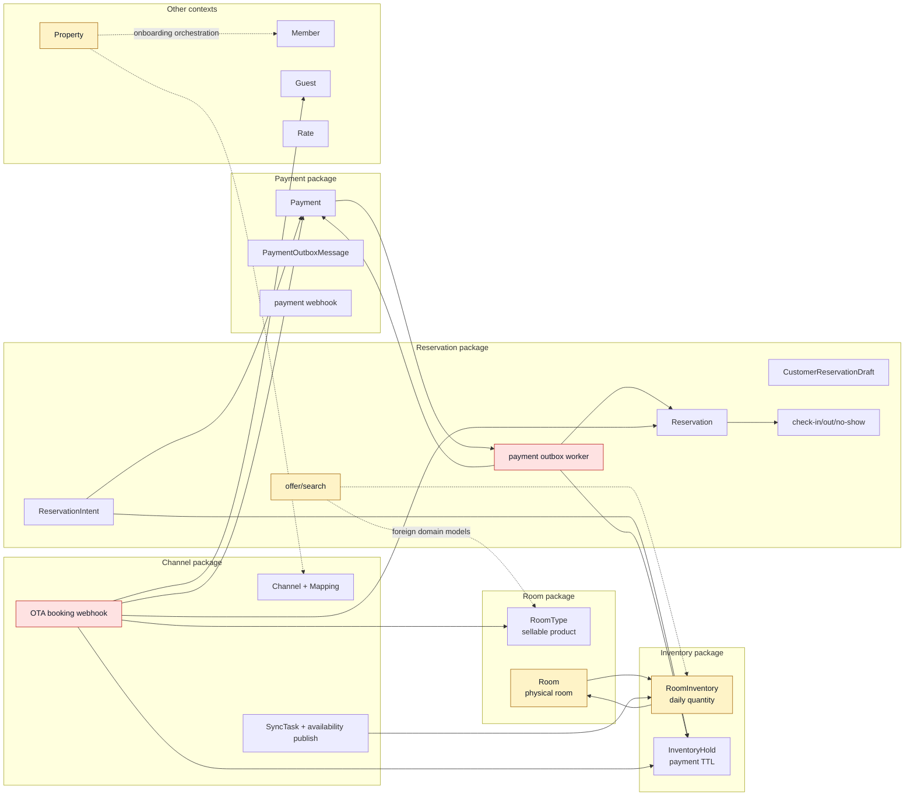
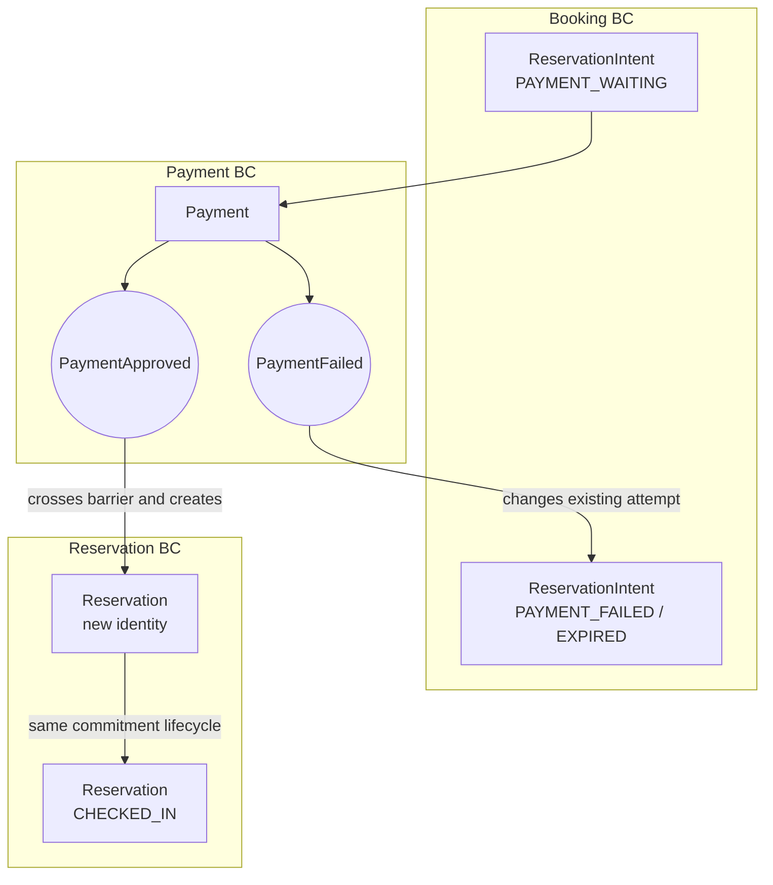
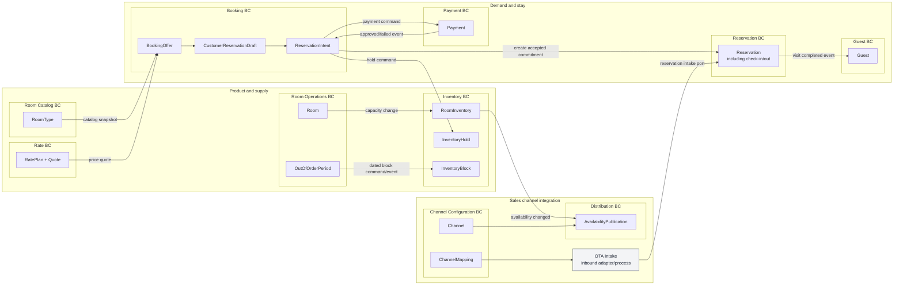

# StayOps Concept Boundary Redesign

> Status: Accepted design baseline (2026-07-22)<br>
> Scope: Domain concept classification, Bounded Context boundaries, dependency correction plan<br>
> Implementation state: Design only; package and production code migration has not started

## 1. Why this document exists

The existing context documents describe the code at different points in time. In particular,
`01-bounded-context-map.md` and `03-domain-diagnosis.md` classify Booking as a use-case module
without its own domain model. The current code no longer matches that conclusion:

- `ReservationIntent` has its own identity, payment-waiting lifecycle, expiry time, hold ID,
  payment ID, and the result Reservation ID.
- `InventoryHold` has its own identity, TTL, and state transitions independent of
  `RoomInventory`.
- A successful direct booking does not merely update `ReservationIntent`; it creates a
  `Reservation`, which has a different lifecycle and business meaning.

This document reclassifies the concepts using the current business rules and code. It is the
target boundary baseline for the following refactoring and ArchUnit rules. The AS-IS catalog
remains as historical evidence and must not be treated as the target architecture.

## 2. Classification rules

The supplied repayment example distinguishes a result inside one concept from a result that
creates another first-class concept across a barrier. StayOps uses the following tests.

1. **Identity test**: Does the concept need to be found and changed by its own ID?
2. **Lifecycle test**: Does it have states, transitions, expiry, or failure recovery that make
   sense independently?
3. **Invariant test**: Does it protect a consistency rule that must be changed through one
   owner?
4. **Language test**: Does the same word mean something different to another business actor?
5. **Change-reason test**: Does it change for a different business policy or external actor?
6. **Creation test**: Does a state/result create a new object with a new identity and lifecycle?
7. **Reuse-pressure test**: If many contexts use it, are they sharing the concept itself when
   they only need an ID, immutable snapshot, query result, or event?

A state machine alone does not make a Bounded Context. `SyncTask`, `PaymentOutboxMessage`, and
processed-webhook records have lifecycles, but those lifecycles exist for delivery and
idempotency. They are technical reliability concepts, not first-class hotel business concepts.

## 3. AS-IS concept barriers

The diagram shows package ownership and the strongest direct dependencies found in the current
code. Red arrows are boundary violations or cycles; dotted arrows are technically valid but
overly broad coupling.



### 3.1 Confirmed AS-IS problems

| Problem | Code evidence | Why the barrier is wrong |
|---|---|---|
| Reservation and Payment form a cycle | `ReservationPaymentOutboxApplication` imports Payment internals, while `PaymentOutboxScheduler` calls back into the Reservation application | Payment delivery is owned by Reservation, so Payment cannot complete independently and both packages become one change unit |
| Booking is hidden inside Reservation | `ReservationIntent`, customer draft, offer search, hold orchestration, and payment waiting all live under `reservation` | A booking attempt and an accepted lodging commitment use different identities and lifecycles |
| Room has two meanings | `RoomType` and physical `Room` share one package | Sale catalog policy and physical-room operations change for different actors and at different rates |
| Room and Inventory form a cycle | Room creation calls Inventory synchronization; Inventory queries `RoomRepository` to derive capacity | Neither context is authoritative at the boundary; capacity can only be understood by traversing both models |
| Maintenance overloads saleability | `RoomStatus.MAINTENANCE` represents an operational state while Inventory only stores an undifferentiated `blockedCount` | A dated Out of Order period cannot be identified, audited, or restored independently |
| Channel contains three jobs | Channel setup/mapping, availability retry, and OTA booking intake share one package | Configuration, outbound distribution, and inbound reservation translation have different actors and failure modes |
| OTA intake owns foreign rules | `WebhookApplication` directly uses Reservation, Payment, Inventory, Guest, and RoomType repositories/services | An integration adapter decides internal booking, pricing, inventory, and guest rules instead of invoking owner contracts |
| Search leaks foreign models | `ReservationSearchApplication` returns `RoomType` and `RoomInventory` directly | A consumer becomes coupled to foreign aggregate shape rather than a local offer/read model |
| Reservation events drive Inventory reads in Channel | `ChannelEventHandler` receives Reservation events and then queries `RoomInventoryRepository` | Distribution cares about an availability change, not the internal reason that caused it |
| Onboarding is stored under Property | `PropertyOnboardingApplication` creates Property and Channel and grants Member access | This is a cross-context business process, not behavior owned by the Property aggregate alone |

### 3.2 Current package to target boundary map

| Current package | Concepts that remain | Concepts that move | Direct access to remove |
|---|---|---|---|
| `reservation` | `Reservation`, cancellation, check-in/out/no-show | Draft, offer, `ReservationIntent` to Booking; payment worker to Payment | Payment models/repos/gateway, Inventory repos, foreign aggregates returned by search |
| `payment` | `Payment`, gateway port, payment webhook | Outbox/idempotency records from `domain.model` to application/infrastructure | Reservation application contracts and snapshots |
| `room` | None under the old umbrella package | `RoomType` to Room Catalog; `Room` to Room Operations | Room-to-Inventory application call |
| `inventory` | Daily inventory, hold, reserve/release invariants | Add `InventoryBlock`; scheduler coordination becomes an owner contract consumer | Property, RoomType, and Room repositories |
| `channel` | None under the old umbrella package | Channel/mapping to Channel Configuration; availability delivery to Distribution; webhook to OTA integration | Reservation, Payment, Inventory, Guest, and RoomType repositories/models |
| `property` | `Property` | onboarding to top-level workflow | Member and Channel repositories from Property application |
| `guest` | `Guest` profile/history | No aggregate move | Keep only the published Reservation checkout event dependency |

The strongest source anchors for these decisions are:

- [`CustomerReservationIntentCreationApplication`](../../../apps/stayops-api/src/main/kotlin/com/stayops/reservation/application/service/CustomerReservationIntentCreationApplication.kt#L33)
  composes Property, Room Catalog, Channel, Rate, Reservation, Inventory, and Payment concerns in
  the hidden Booking flow.
- [`ReservationPaymentOutboxApplication`](../../../apps/stayops-api/src/main/kotlin/com/stayops/reservation/application/service/ReservationPaymentOutboxApplication.kt#L36)
  owns Payment repositories/gateway processing and later creates Reservation and consumes the
  hold; [`PaymentOutboxScheduler`](../../../apps/stayops-api/src/main/kotlin/com/stayops/payment/infrastructure/scheduler/PaymentOutboxScheduler.kt#L10)
  points back to it from Payment infrastructure.
- [`ReservationSearchApplication`](../../../apps/stayops-api/src/main/kotlin/com/stayops/reservation/application/service/ReservationSearchApplication.kt#L36)
  reads and returns Room Catalog and Inventory domain objects instead of Booking-owned offer
  snapshots.
- [`RoomApplication`](../../../apps/stayops-api/src/main/kotlin/com/stayops/room/application/service/RoomApplication.kt#L13)
  calls Inventory after creating a physical room, while
  [`RoomInventorySyncApplication`](../../../apps/stayops-api/src/main/kotlin/com/stayops/inventory/application/service/RoomInventorySyncApplication.kt#L15)
  queries the Room repository to derive capacity.
- [`WebhookApplication`](../../../apps/stayops-api/src/main/kotlin/com/stayops/channel/application/service/WebhookApplication.kt#L33)
  directly orchestrates five foreign business contexts;
  [`ChannelEventHandler`](../../../apps/stayops-api/src/main/kotlin/com/stayops/channel/application/service/ChannelEventHandler.kt#L11)
  infers availability publication from Reservation events and Inventory persistence.
- [`PropertyOnboardingApplication`](../../../apps/stayops-api/src/main/kotlin/com/stayops/property/application/service/PropertyOnboardingApplication.kt#L28)
  is the existing cross-context Property, Member, and Channel workflow.

## 4. First-class concepts and subordinate behavior

### 4.1 Core and supporting business concepts

| First-class concept / BC | Owns | Important subordinate behavior | Barrier rationale |
|---|---|---|---|
| Property | Hotel/property identity and property policy | create, update, operating configuration | Tenant/business identity used by all contexts but mutated only here |
| Member | User identity, role, property access | invite, grant/revoke access | Security actor and access lifecycle differ from hotel operations |
| Room Catalog | `RoomType`, sellable room attributes | publish/update room type, sales attributes | A sellable product, not a physical room or daily stock |
| Room Operations | physical `Room`, housekeeping/occupancy status, `OutOfOrderPeriod` | assign operational status, mark cleaning, open/close dated OOO period | Physical operations and dated serviceability have their own actors and lifecycle |
| Inventory | `RoomInventory`, `InventoryHold`, `InventoryBlock` | reserve, release, hold, consume, expire, block/unblock | Sole owner of availability and overbooking invariants |
| Rate | `RatePlan`, price quote policy | resolve price for dates/channel/occupancy | Price is not a RoomType attribute and must have one policy owner |
| Booking | `CustomerReservationDraft`, `ReservationIntent` | search offer, create attempt, wait for payment, expire/fail/cancel, convert to Reservation | Customer booking attempt exists before an accepted Reservation and has TTL/failure recovery |
| Payment | `Payment` | request confirmation, approve/fail, cancel/refund | Financial transaction and gateway outcome lifecycle |
| Reservation | `Reservation` | confirm, cancel, check-in, check-out, no-show | Accepted lodging commitment and stay-operation lifecycle |
| Guest | `Guest` profile/history | create/update profile, record completed visit, tier policy | Guest identity/history outlives one Reservation |
| Channel Configuration | `Channel`, `ChannelMapping` | connect/suspend OTA, map internal and external codes | Source of truth for an OTA connection and translation rules |
| Distribution | availability publication request | create delivery, lease, publish, retry, complete/fail | Operational capability triggered by availability changes; independent of reservation intake |

Settlement remains a supporting financial context. Statistics and Dashboard remain CQRS/read
models unless they acquire independent commands and invariants.

### 4.2 Concepts that do not become a BC

| Concept | Placement | Reason |
|---|---|---|
| Payment outbox record | Payment application/infrastructure | Delivery mechanism for a Payment command, not hotel language |
| Processed payment webhook | Payment infrastructure | Idempotency ledger |
| Distribution task storage/lease | Distribution application/infrastructure | Retry mechanism; the business meaning is availability publication |
| Processed OTA webhook | OTA integration infrastructure | Idempotency ledger |
| OTA Intake | Top-level inbound integration/application process | Translates an external contract and invokes owner use cases; owns no hotel aggregate |
| Property Onboarding | Top-level workflow/application process | Coordinates Property, Member, and Channel Configuration without owning their models |

### 4.3 How reuse pressure is interpreted

“Used by many places” is a boundary-discovery signal, not an automatic reason to create a BC.

- `RoomType` is both widely used and independently managed as a sellable product, so Room Catalog
  becomes its owner. Consumers receive an ID or catalog snapshot.
- `Reservation` is used by Guest history, Settlement, Channel, and dashboards, but those consumers
  need facts or projections. They receive integration events/read models instead of sharing the
  Reservation aggregate.
- `PropertyId`, `Money`, and time values are widely used but do not have an independent lifecycle.
  They remain stable value types and do not become contexts.
- `SyncTask` is used by scheduler, dashboard, and publisher code, but this is reuse inside one
  delivery mechanism. It is not promoted to a hotel business context.

## 5. State change versus creation of a new concept



The decisions are:

- **Payment approval creates Reservation** for the direct-customer booking flow. This crosses a
  barrier because Reservation has a new ID, policies, and stay lifecycle.
- **Payment failure does not create a new Failure BC.** It changes the Booking attempt and causes
  the owned Inventory hold to be released.
- **Check-in does not create a separate Stay aggregate in the current single-room scope.** It is
  a Reservation lifecycle transition. A separate Stay concept is reconsidered only when a single
  reservation must own multiple independently assigned room stays or folios.
- **A dated physical-room outage creates `OutOfOrderPeriod`.** It is not merely
  `Room.status = MAINTENANCE`, because the period has dates, reason, return status, audit, and an
  independent effect on sellable inventory.
- **A pre-payment hold creates `InventoryHold`.** It has TTL and release/consume transitions, so
  it cannot be represented only by `RoomInventory.heldCount`.

## 6. TO-BE concept barriers



### 6.1 Ownership and dependency rules

1. A context may import another context's `application.provided` contract or published
   integration event. It may not import the other context's aggregate, domain repository,
   application service implementation, persistence model, or adapter.
2. Cross-context commands carry IDs and immutable input values. Cross-context query results are
   consumer-oriented snapshots, not foreign aggregates.
3. Each business mutation has one owner:
   - availability counts and hold/block invariants: Inventory;
   - price quote: Rate;
   - payment state: Payment;
   - accepted lodging commitment and check-in/out: Reservation;
   - OTA connection and mappings: Channel Configuration.
4. A cross-context workflow belongs in a top-level workflow/integration application package. It
   coordinates public contracts and never imports foreign repositories.
5. Integration events describe an owner fact. Distribution consumes
   `InventoryAvailabilityChanged`; it must not infer availability by consuming Reservation events
   and querying Inventory storage.
6. `shared` contains stable technical primitives and genuinely shared value types only. It is not
   a place for context-specific DTOs or integration orchestration.

### 6.2 Required public contracts

| Owner | Public contract/event | Consumer and purpose |
|---|---|---|
| Room Catalog | `RoomTypeSnapshotQuery` | Booking offer and integration mapping receive ID, name, capacity, and sales attributes without importing `RoomType` |
| Rate | `RateQuoteQuery` | Booking and OTA Intake request the authoritative date/channel price |
| Inventory | `InventoryHoldUseCase`, `InventoryReservationUseCase`, `InventoryBlockUseCase` | Booking, Reservation workflows, and Room Operations request owner-controlled mutations |
| Inventory | `InventoryAvailabilityChanged` | Distribution creates or coalesces publication work from the new availability snapshot |
| Booking | `CustomerBookingUseCase` | Customer API creates/cancels an attempt without touching Reservation or Payment internals |
| Payment | `PaymentUseCase` and `PaymentApproved`/`PaymentFailed`/`PaymentCancelled` | Booking reacts to outcomes; no Payment scheduler calls Reservation application code |
| Reservation | `ReservationIntakeUseCase` | Booking, PMS manual intake, and OTA Intake create/cancel a Reservation through explicit source-specific commands |
| Room Operations | `RoomCapacityChanged`, `RoomOutOfOrderChanged` | Inventory updates capacity or creates/removes dated blocks idempotently |
| Channel Configuration | `ChannelConfigurationQuery` | Distribution and OTA Intake resolve active connection and mappings |

The HTTP request/response contracts and existing database IDs remain unchanged during package
migration. Persistence collection/table renames require a separate migration decision and are
out of scope for this boundary refactoring.

## 7. Package target

```text
com.stayops
├── booking
├── reservation
├── payment
├── inventory
├── rate
├── roomcatalog
├── roomoperations
├── guest
├── property
├── member
├── channelconfiguration
├── distribution
├── integration
│   └── ota
├── workflow
│   └── onboarding
└── shared
```

Every business context keeps `api`, `application.provided`, `application.service`,
`application.required`, `domain`, and `infrastructure` only where those layers are needed.
`integration` and `workflow` have no domain model or repository layer.

## 8. Migration plan

Each phase follows test-first migration, preserves HTTP/database compatibility, and stops for
review before the next phase.

### Phase 1: Document and dependency baseline

- Accept this concept map as the target architecture and mark older AS-IS conclusions as
  historical rather than silently rewriting them.
- Add ArchUnit JUnit 5 tests using the existing `archunit-junit5:1.3.0` dependency.
- Enforce immediately green rules as hard failures: domain framework purity, inward layer
  direction, no API-to-infrastructure access, and no foreign domain-repository imports.
- Wrap only existing broad package-cycle violations in `FreezingArchRule`; commit the initial
  violation store, forbid store creation/update in CI, and reduce it locally with each phase.
- Replace `ServiceNamingConventionTest`'s obsolete “Booking is not a BC” assertion when the
  Booking package is introduced.

### Phase 2: Extract Booking and return Payment ownership

- Move `ReservationIntent`, its repository/persistence mapping, customer draft, offer search,
  and intent lifecycle into `booking` without changing stored identifiers or API payloads.
- Replace `ReservationSearchApplication` foreign aggregate return types with Booking-owned offer
  snapshots obtained through Room Catalog, Rate, and Inventory query contracts.
- Move payment outbox processing into Payment application/infrastructure. Keep outbox and
  processed-webhook records out of the core Payment model package.
- Publish idempotent Payment outcome events. Booking consumes approval to consume the hold and
  create Reservation exactly once; failure/expiry releases the hold exactly once.
- Remove Payment-to-Reservation and Reservation-to-Payment implementation imports, then remove
  those violations from the freeze baseline.

### Phase 3: Split Room Catalog and Room Operations

- Move `RoomType` to Room Catalog and physical `Room` to Room Operations while preserving API and
  persistence names.
- Introduce dated `OutOfOrderPeriod` in Room Operations and corresponding `InventoryBlock` in
  Inventory. `blockedCount` remains a projection, not the source business object.
- Do not automatically remove stock for a maintenance work request. Only an explicit OOO period
  affects saleability; housekeeping/occupancy status remains operational.
- Replace Inventory queries to `RoomRepository` with idempotent capacity and OOO change contracts.
- Remove the Room-to-Inventory cycle and harden the related ArchUnit rule.

### Phase 4: Split Channel Configuration, Distribution, and OTA Intake

- Move `Channel` and `ChannelMapping` to Channel Configuration.
- Move availability publication, retry/lease behavior, scheduler, publisher adapters, and
  dashboards around delivery to Distribution. Rename the business-facing concept from generic
  `SyncTask` to `AvailabilityPublication`; technical lease/outbox details stay internal.
- Move webhook API, signature verification, external DTO mapping, and idempotency storage to
  `integration.ota`.
- Replace direct Reservation, Payment, Inventory, Guest, RoomType repository calls with owner
  contracts. OTA intake uses the Rate quote policy instead of `RoomType.basePrice`.
- Trigger Distribution from `InventoryAvailabilityChanged`, removing Reservation event and
  Inventory repository dependencies from channel code.

### Phase 5: Isolate cross-context workflows and read models

- Move property onboarding orchestration to `workflow.onboarding`; keep Property, Member, and
  Channel Configuration mutations behind their provided contracts.
- Keep Reservation check-in/out/no-show behavior in Reservation. Continue publishing
  `ReservationCheckedOut` for Guest history through a stable integration event.
- Keep Settlement, Statistics, and Dashboard as supporting/read contexts and replace aggregate
  imports with immutable projections where needed.
- Remove the final freeze store and enforce top-level
  `slices().matching("com.stayops.(*)..").should().beFreeOfCycles()` as a hard rule, excluding
  explicitly technical top-level packages only when documented.

## 9. ArchUnit target rules

The architecture suite will use `@AnalyzeClasses(packages = ["com.stayops"])` and JUnit 5
`@ArchTest` fields so imported classes are cached. Rules are grouped by intent rather than placed
in one large test.

1. **Layer rules**
   - Domain must not depend on Spring, persistence annotations, application, API, or
     infrastructure.
   - Application must not depend on API or infrastructure.
   - API may depend on its context's provided application contract/DTO only.
   - Infrastructure may implement its context's required ports and repositories but may not
     access another adapter.
2. **Context ownership rules**
   - A foreign context cannot import `..domain.repository..`, `..application.service..`,
     `..infrastructure..`, or persistence documents.
   - Cross-context access is limited to `..application.provided..` and `..integrationevent..`.
   - `integration..` and `workflow..` may depend on provided contracts but cannot declare domain
     repositories.
3. **Explicit high-risk rules**
   - Payment has no dependency on Booking or Reservation implementations.
   - Reservation has no dependency on Payment internals.
   - Room Catalog and Room Operations do not query Inventory persistence, and Inventory does not
     query Room persistence.
   - Distribution has no dependency on Reservation and no Inventory repository dependency.
   - OTA integration has no foreign domain repository dependency.
4. **Cycle rule**
   - During migration: freeze only the measured current top-level package cycles.
   - Target: all first-level business-context slices are cycle-free without freezing.

`FreezingArchRule` is a migration ledger, not an exception mechanism. It records existing
violations and rejects new ones; when a violation is fixed the stored baseline must shrink. New
target packages and newly introduced rules are never frozen.

## 10. Verification and acceptance scenarios

### Business behavior

- Concurrent last-room attempts allow only one Inventory hold.
- A multi-date hold either succeeds for every date or rolls back every date.
- Booking expiry and Payment failure release the hold exactly once.
- Payment approval consumes the hold and creates one Reservation even when the outcome is
  delivered repeatedly.
- Manual PMS and OTA intake can create accepted Reservations without pretending to be the
  direct-customer payment-waiting Booking flow.
- Check-in, check-out, cancellation, and no-show retain their current Reservation behavior.
- An OOO period blocks only its date range and restores availability when closed; an operational
  maintenance/housekeeping state alone does not change sellable inventory.
- Capacity and OOO events update Inventory idempotently.
- One availability change creates/coalesces Distribution work without reading Reservation.
- Repeated OTA webhooks remain idempotent and use the authoritative Rate quote.

### Architecture and compatibility

- Targeted context tests pass after every phase, followed by
  `./gradlew :apps:stayops-api:test` and finally `./gradlew test`.
- Existing HTTP contracts, database IDs, and collection/table names remain compatible.
- The frozen violation count only decreases; CI cannot create or update the baseline.
- Completion requires the unfrozen top-level cycle rule to pass.

## 11. Decision log

- Booking is a separate BC and `ReservationIntent` is its Aggregate Root.
- Inventory, not Booking, owns overbooking prevention and hold-count invariants.
- Check-in/out/no-show remain in the Reservation lifecycle; no Stay BC is introduced now.
- Room Catalog and Room Operations are separate BCs.
- Dated Out of Order is modeled separately from physical-room maintenance/housekeeping status.
- Channel Configuration and Distribution are separate BCs; OTA Intake is an inbound adapter and
  cross-context application process.
- Technical outbox, retry, and idempotency records are not promoted to hotel business BCs.

## 12. References

- [ArchUnit User Guide](https://www.archunit.org/userguide/html/000_Index.html): package/layer
  rules, slices, JUnit 5 support, and `FreezingArchRule` migration behavior.
- [ArchUnit motivation](https://www.archunit.org/motivation): architecture rules as executable CI
  constraints.
- [KakaoPay credit-core DDD case](https://tech.kakaopay.com/post/backend-domain-driven-design/):
  explicit Bounded Contexts, Aggregate transaction boundaries, and single ownership of domain
  functions.
- [Martin Fowler: Bounded Context](https://martinfowler.com/bliki/BoundedContext.html): explicit
  model boundaries and context-specific language.
- [Oracle OPERA reservation overview](https://docs.oracle.com/en/industries/hospitality/opera-cloud/22.3/ocsuh/c_about_reservations.htm):
  temporary inventory hold and Reservation-centered check-in lifecycle.
- [Oracle OPERA reservation types](https://docs.oracle.com/en/industries/hospitality/opera-cloud/25.1/ocsuh/c_admin_booking_reservation_types.htm):
  deduct/non-deduct, tentative, guarantee, and hold policies.
- [Oracle OPERA Out of Order](https://docs.oracle.com/cd/F34189_01/doc.201/f42091/t_housekeeping_out_of_order.htm):
  dated OOO periods and their inventory effect.
- [Booking.com Demand API order flow](https://developers.booking.com/demand/docs/orders-api/order-preview-create):
  time-limited preview token followed by booking/payment confirmation.
- [Mews reservation operations](https://docs.mews.com/connector-api/operations/reservations):
  confirmed, started/check-in, and processed/check-out Reservation states.
