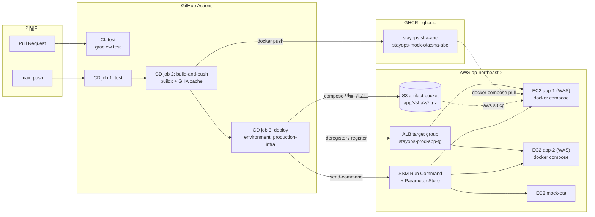
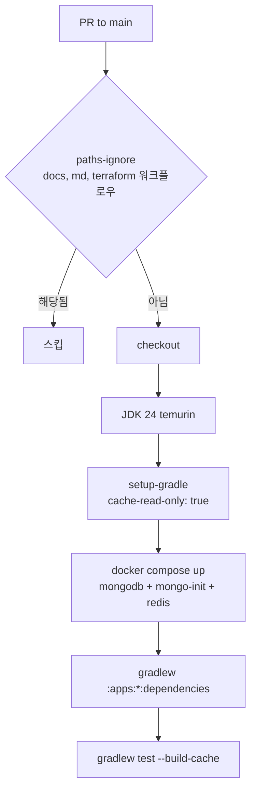
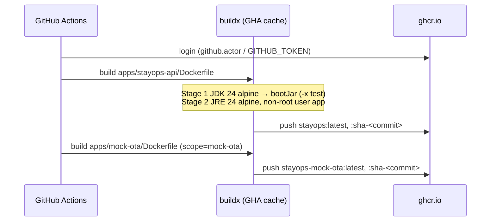
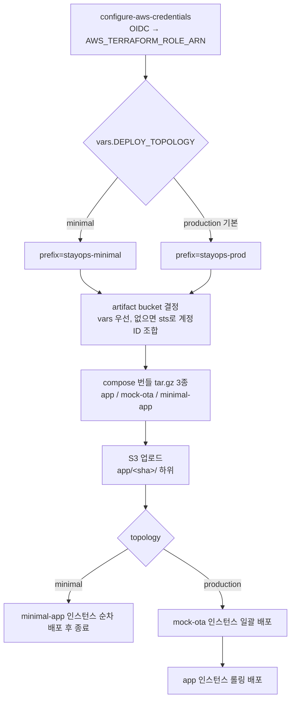
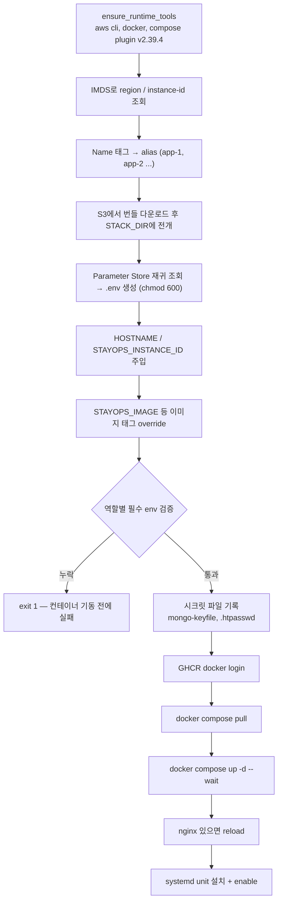

# CI/CD 파이프라인 구조

> 작성일: 2026-09-05
> 대상: `.github/workflows/ci.yml`, `.github/workflows/deploy.yml`, `infra/production/scripts/install-compose-stack.sh`

---

## 0. 용어 정정: Docker Hub가 아니라 GHCR

현재 파이프라인은 **Docker Hub를 사용하지 않는다.** 이미지 레지스트리는
**GHCR(GitHub Container Registry, `ghcr.io`)** 이며, 인증은 워크플로우에 자동 주입되는
`secrets.GITHUB_TOKEN`(`packages: write` 권한)으로 처리된다. 서버 측 pull 인증은
SSM Parameter Store의 `GHCR_USERNAME` / `GHCR_TOKEN`을 사용한다.

| 항목 | 값 |
|---|---|
| 레지스트리 | `ghcr.io` |
| API 이미지 | `ghcr.io/<owner>/stayops:latest`, `:sha-<commit>` |
| Mock OTA 이미지 | `ghcr.io/<owner>/stayops-mock-ota:latest`, `:sha-<commit>` |
| CI 인증 | `docker/login-action` + `GITHUB_TOKEN` |
| 서버 인증 | SSM Parameter Store의 `GHCR_USERNAME`/`GHCR_TOKEN`으로 `docker login` |

배포에 실제로 참조되는 태그는 `latest`가 아니라 **`sha-<commit>`** 이다. 롤백 지점이 커밋 단위로
고정되고, 롤링 도중 인스턴스마다 다른 이미지를 받는 상황이 발생하지 않는다.

---

## 1. 전체 흐름



핵심은 **GitHub Actions가 서버에 SSH로 붙지 않는다**는 점이다.
OIDC로 AWS 역할을 assume하고, 실행 명령은 SSM Run Command로 전달한다.
따라서 배포 경로에 상시 개방된 SSH 포트나 장기 크레덴셜이 없다.

---

## 2. CI (Pull Request)

`.github/workflows/ci.yml` — `main` 대상 PR에서만 동작한다.



- 권한은 `contents: read`만 부여 — PR 컨텍스트에서 쓰기 권한을 주지 않는다.
- Testcontainers가 아니라 **Runner에 직접 띄운 MongoDB/Redis 컨테이너**를 테스트가 사용한다.
- `cache-read-only: true` — PR 빌드가 Gradle 캐시를 오염시키지 않는다. 캐시 쓰기는 CD만 한다.
- CI는 이미지를 만들지 않는다. 검증까지가 책임 범위.

---

## 3. CD (main push)

`.github/workflows/deploy.yml` — `push: main` 또는 `workflow_dispatch`.

```
concurrency: group=stayops-app-deploy, cancel-in-progress=false
```

동시 배포를 직렬화하되 **진행 중인 배포는 취소하지 않는다.** 롤링 중간에 워크플로우가
죽으면 ALB에서 빠진 인스턴스가 복귀하지 못한 채 남기 때문이다.

### job 1 — test

CI와 동일한 테스트를 다시 수행한다. 차이는 Gradle 캐시가 **쓰기 가능**이라는 점.

### job 2 — build-and-push



- 두 이미지는 `cache-from/to: type=gha`를 쓰되 **scope를 분리**해 서로의 레이어 캐시를 덮어쓰지 않는다.
- 이미지 빌드 단계에서 테스트는 제외한다(`-x test`). 테스트는 job 1이 이미 통과시킨 책임이다.
- 런타임 스테이지는 JRE + non-root(`USER app`) + `MaxRAMPercentage=75`.

### job 3 — deploy

`environment: production-infra`에 묶여 있어 environment 보호 규칙(승인/시크릿 스코프)이 적용된다.



**아티팩트로 올라가는 것은 이미지가 아니라 compose 정의다.** 이미지는 GHCR, 실행 정의는 S3,
설정값은 SSM Parameter Store로 각각 분리되어 있다.

---

## 4. 롤링 배포 (production app)

```mermaid
sequenceDiagram
    participant GHA as GitHub Actions
    participant ALB as ALB target group
    participant SSM as SSM Run Command
    participant EC2 as EC2 app-N (WAS)
    participant S3 as S3
    participant PS as Parameter Store
    participant GHCR as ghcr.io

    GHA->>ALB: describe-target-health
    Note over GHA: healthy < 2 면 즉시 실패
    loop app-1, app-2 순차
        GHA->>ALB: deregister-targets + wait target-deregistered
        GHA->>ALB: 남은 healthy >= 1 확인
        GHA->>SSM: send-command (install-compose-stack.sh)
        SSM->>EC2: AWS-RunShellScript
        EC2->>S3: install-compose-stack.sh + app.tgz 다운로드
        EC2->>PS: get-parameters-by-path /stayops/prod/app → .env 생성
        Note over EC2: 필수 env 검증, 시크릿 파일 기록<br/>STAYOPS_IMAGE=sha-&lt;commit&gt; 주입
        EC2->>GHCR: docker login + docker compose pull
        EC2->>EC2: docker compose up -d --wait (timeout 180s)
        EC2->>EC2: systemd unit stayops-app.service 설치/enable
        SSM-->>GHA: Status / stdout / stderr
        Note over GHA: Success 아니면 배포 중단 (재등록 없음)
        GHA->>ALB: register-targets + wait target-in-service
    end
```

### 안전장치

| 장치 | 목적 |
|---|---|
| 인스턴스 2대 미만이면 실패 | 무중단 전제 자체가 성립하지 않음 |
| 시작 시 healthy 2 미만이면 실패 | 이미 불안정한 상태에서 배포를 얹지 않음 |
| deregister 후 healthy 1 미만이면 실패 | 트래픽 받을 인스턴스가 0이 되는 것을 차단 |
| `wait target-deregistered` | connection draining 완료 후 컨테이너 교체 |
| `compose up --wait` + healthcheck | `/actuator/health`가 UP일 때까지 대기 후 다음 단계 |
| `stop_grace_period: 40s` | 진행 중 요청 처리 시간 확보 |
| SSM 실패 시 즉시 exit | **실패한 인스턴스를 ALB에 되돌리지 않는다** |

마지막 항목은 의도된 동작이다. 배포 실패 시 해당 인스턴스는 ALB에서 빠진 채 남고,
남은 인스턴스가 트래픽을 받는다. 자동 롤백 대신 "고장난 노드를 트래픽에서 격리"를 택한 형태다.

---

## 5. 서버(WAS) 측 동작 — install-compose-stack.sh

SSM이 EC2에서 실행하는 단일 진입점이며, 역할(`app` / `mock-ota` / `minimal-app` / `mongodb-rss` / `redis` / `observability`)을
인자로 받아 분기한다.



설계상 눈여겨볼 지점:

- **설정은 이미지에 굽지 않는다.** DB URL, Toss 시크릿, Redis 호스트 등은 전부 Parameter Store에서
  배포 시점에 `.env`로 내려온다. 동일한 이미지가 topology(production/minimal)에 관계없이 재사용된다.
- **필수 env 검증이 `compose up`보다 앞에 있다.** 값이 비어 있으면 컨테이너를 띄우기 전에 실패하므로,
  ALB에서 빠진 상태로 기동 실패가 반복되는 상황을 피한다.
- **`STAYOPS_INSTANCE_ID`를 인스턴스 Name 태그에서 유도**해 로그/메트릭에서 노드를 식별한다.
- **systemd unit을 매 배포마다 재설치**한다. EC2 재부팅 시 compose 스택이 자동 복구된다.

---

## 6. 신뢰 경계와 크레덴셜

| 구간 | 인증 방식 | 장기 크레덴셜 |
|---|---|---|
| Actions → GHCR | `GITHUB_TOKEN` (job 한정) | 없음 |
| Actions → AWS | OIDC `id-token: write` → role assume | 없음 |
| Actions → EC2 | SSM Run Command (SSH 미사용) | 없음 |
| EC2 → S3 / Parameter Store | 인스턴스 프로파일 IAM 역할 | 없음 |
| EC2 → GHCR | Parameter Store의 `GHCR_TOKEN` | **있음 (유일)** |

장기 크레덴셜이 남은 구간은 EC2의 GHCR pull 하나뿐이며, 이 값도 코드가 아니라 Parameter Store에 있다.

---

## 7. 현재 구조의 한계

1. **테스트 중복 실행** — CI(PR)와 CD(main)가 같은 테스트를 두 번 돌린다. squash merge 기준으로는
   커밋이 달라지므로 완전한 낭비는 아니지만, 배포 리드타임에 테스트 시간이 그대로 더해진다.
2. **자동 롤백 없음** — 실패 시 격리까지만 하고 이전 `sha-` 이미지로 되돌리는 단계가 없다.
   재배포는 수동(`workflow_dispatch`) 또는 revert 커밋에 의존한다.
3. **mock-ota는 일괄 배포** — app만 롤링이고 mock-ota는 동시에 교체되어 짧은 단절이 가능하다.
   테스트용 종속 서비스라 허용한 트레이드오프.
4. **스모크 테스트 부재** — `--wait`와 `/actuator/health`까지만 확인하고, 실제 예약/결제 경로를
   호출하는 배포 후 검증은 없다.
